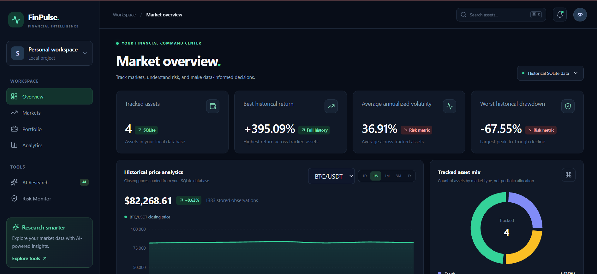

# FinPulse

[](https://github.com/sandipp00/FinPulse/actions/workflows/ci.yml)

FinPulse is a Python-based financial analytics platform for exploring stock market and cryptocurrency data, comparing historical performance, and evaluating investment risk.

## Features

- Historical market data ingestion for NIFTY 50, Apple, Bitcoin, and Ethereum
- SQLite database for unified market data storage
- Financial metrics including daily returns, cumulative growth, annualized volatility, Sharpe ratio, and maximum drawdown
- Interactive Streamlit dashboard with Plotly charts
- React frontend with interactive financial charts
- Live candlestick charts (1m / 15m / 1h / 1d) with volume, SMA, EMA, Bollinger Bands, RSI and MACD; the current candle updates in real time
- FastAPI backend for serving historical market data and financial metrics
- Live crypto prices streamed from Binance over WebSockets (ticker bar, live cards with sparklines, flashing price changes)
- Buy/sell signals from six transparent indicator rules (trend, MA cross, RSI, MACD, Bollinger, volume), each with a plain-language reason, plus a historical backtest vs buy-and-hold beside every rating
- Email-and-password accounts (scrypt hashing, httpOnly session cookies) with optional email verification and emailed password reset, so every person gets their own paper account
- Paper trading with a virtual $100k account: market orders at live Binance prices (0.1% fee, long-only), holdings with live P&L, equity curve, order history, and a one-click "follow the signal" mode
- Asset-class and date-range filters
- CSV export of financial summaries
- Automated tests using pytest

## Technology Stack

Python · Pandas · NumPy · SQLite · SQLAlchemy · yfinance · CCXT · FastAPI · React · Vite · Tailwind CSS · Recharts · Plotly · Streamlit · scikit-learn · pytest

## Project Structure

```text
FinPulse/
├── backend/
│   ├── __init__.py
│   └── main.py
├── dashboard/
│   └── app.py
├── frontend/
│   ├── src/
│   ├── package.json
│   └── vite.config.js
├── src/
│   ├── analytics/
│   └── data/
├── tests/
├── requirements.txt
├── .gitignore
└── README.md
```

## Run with Docker

The quickest way to run everything (free, no accounts needed):

```bash
docker compose up -d --build     # then open http://localhost:8080
```

See [docs/DEPLOYMENT.md](docs/DEPLOYMENT.md) for HTTPS, free hosting options, backups and account administration.

## Setup (development)

### 1. Python Environment

Create and activate a Python virtual environment, then install dependencies:

```bash
pip install -r requirements.txt
```

### 2. Prepare Market Data

Collect historical data using the data ingestion scripts and build the SQLite database using:

```bash
python src/data/build_database.py
```

### 3. Configure (optional)

Copy `.env.example` to `.env` (backend) and `frontend/.env.example` to `frontend/.env.local` to change the API URL, CORS origins, live symbols, or Binance endpoints. Defaults work for local development.

### 4. Start the FastAPI Backend

From the project root:

```bash
python -m uvicorn backend.main:app --reload
```

The API runs at `http://127.0.0.1:8000`. On startup it connects to Binance's public streams (no API key) and exposes live prices at `ws://127.0.0.1:8000/ws/prices`, `GET /api/live/status` and `GET /api/live/ticks`. Closed 1-minute candles are stored in the `live_candles` table, and `GET /api/candles?symbol=BTC/USDT&interval=1h&limit=500` returns OHLCV history from Binance (intervals: `1m`, `15m`, `1h`, `1d`). `GET /api/signals?interval=1d[&symbol=BTC/USDT]` returns the ratings and reasons, and `GET /api/backtest?symbol=BTC/USDT&interval=1d&fee_pct=0.1` returns the backtest. Set `LIVE_FEED_ENABLED=false` to turn the feed off.

Interactive API documentation is available at `http://127.0.0.1:8000/docs`.

### 5. Start the React Frontend

Open a separate terminal:

```bash
cd frontend
npm install
npm run dev
```

Open `http://localhost:5173` in your browser. The dev server forwards `/api` and `/ws` to the backend on port 8000, so the browser only ever sees one origin (this is what lets the login cookie work).

## Dashboard Preview



FinPulse displays historical market prices, asset performance, volatility, and maximum drawdown using locally stored market data.

### 6. Start the Streamlit Dashboard

From the project root:

```bash
python -m streamlit run dashboard/app.py
```

## Testing

Run the automated Python tests (the minimal dependencies for this are in `requirements-dev.txt`):

```bash
pip install -r requirements-dev.txt
python -m pytest -v
```

Run the frontend unit tests (indicator math, live-candle logic, portfolio valuation, email-link parsing):

```bash
cd frontend
npm test
```

## Market data and freshness

Every number the API serves says where it came from and how fresh it is (models in `backend/schemas/market.py`):

- `GET /api/market/quotes` returns one normalized record per instrument: symbol, asset class, price, quote currency (crypto pairs are priced in USDT, not USD), unit, provider, provider timestamp, retrieval time, interval and a status. The status is `real_time` for a recent exchange tick, `stale` when the tick is older than 30 seconds or the feed is down, `historical` for a stored daily close, `cached` for a kept response, and `unavailable` when there is nothing. A currency that is not known is `null`, never guessed.
- `GET /api/candles` adds a `meta` object: provider, the endpoint that answered, retrieval time, the newest bar's time and the cache age.

- `GET /api/instruments` lists every instrument that can be charted: its asset class, quote currency, unit, whether it is live, the intervals it offers, and its stored coverage (bars, first and last date).
- `GET /api/instruments/history?symbol=AAPL&interval=1d&limit=500` returns OHLCV bars for any of them in one format, with `meta`. Live crypto comes from Binance (`1m`, `15m`, `1h`, `1d`; 50-1000 bars). Stored instruments are daily only (up to 5000 bars). Add `source=database` to get a live coin's stored history instead. If Binance fails on a daily request and stored bars exist, those are returned, `source` says `database`, and a note in `meta.notes` explains why.

In the explorer, a comparison keeps only the dates both instruments share (daily bars are matched by UTC day), and rebases both to 100. Prices are not converted between currencies, and the page says so when they differ.

### FX rates: live quotes (Yahoo) and ECB reference rates (via Frankfurter)

- **Live:** every pair on the FX page is quoted from Yahoo Finance every 15 seconds (see *Live stock, index and FX quotes* below) and charted from Yahoo's chart API at 1m, 15m, 1h and 1d (`GET /api/instruments/history?symbol=EUR/USD&interval=15m`, `source: "yahoo"`, in `backend/yahoo_history.py`). Candles are cached for 20 seconds and kept, labelled `cached`, for up to 10 minutes if Yahoo fails. The newest bar is still forming and follows each live tick. Yahoo's 1-minute FX bars are single prices, so they are drawn as a line; Yahoo reports no FX volume.
- **Reference:** each card also shows the ECB rate, and the ECB history is kept below the live chart. The rest of this section describes the ECB rates.

- **Source:** euro foreign exchange reference rates from the European Central Bank, fetched through the free, open-source [Frankfurter](https://frankfurter.dev/) API (`providers=ecb`). No key is needed. `FX_BASE_URL` can point at a self-hosted Frankfurter.
- **Freshness:** the ECB publishes them around 16:00 CET on TARGET working days, "for information purposes only". They are labelled `HIST` with their date, never as live. Weekends and holidays have no rate, and none is filled in.
- **Derived pairs:** the ECB publishes only rates against the euro. GBP/USD, USD/JPY and USD/INR are cross rates that FinPulse calculates from the same day's two euro rates (for example USD/INR = EUR/INR ÷ EUR/USD). The ECB's reuse terms require changes to be stated, so these pairs are marked *Derived cross*, and their `method` field says how they were calculated.
- **Endpoints:** `GET /api/fx/pairs` returns each pair's latest and previous rate, the change, whether it is derived, and source metadata. `GET /api/fx/history?pair=USD/INR` returns ten years of daily rates.
- **Requests, caching and failures:** one request fetches every currency for the whole window. It is cached for an hour. When the source fails, the last response is served for up to three days, labelled `cached`. A 429 is honoured using its `Retry-After`.
- Frankfurter's default "blended" rate is its own mix of many providers and can differ from the ECB's (on 29 Oct 2026, EUR/USD was 1.1158 blended against 1.1130 from the ECB). FinPulse asks for the ECB's rate so that the source is a single, citable one.

### Research assistant

`/assistant` answers questions such as "How has AAPL performed?", "Compare Bitcoin with the S&P 500", "What is US inflation?", "USD/INR rate" or "What's on the calendar this week?". It uses nine read-only tools (`backend/research_tools.py`): quote, performance, compare, backtest, news, calendar, macro, FX and oil. Every figure is labelled *data* (as published) or *calculated* (by FinPulse's tested functions), and every source is listed with its time. Nothing is traded or changed. Both modes are free.

- **Rule-based** (`backend/assistant_rules.py`, always on). It recognizes instrument names and question types, runs the matching tools, and writes the answer from fixed templates. There is no AI model: it cannot invent a number, it never interprets or predicts, and it says so when a question is outside what it handles.
- **Local AI** (`backend/assistant_local.py`, optional). A model running in [Ollama](https://ollama.com) on your own computer, so nothing leaves the machine. It calls the same tools and is instructed to answer only from their results and to cite them. Small local models can still state numbers they were not given, so **every number in the answer is checked against the tool results**, and any it cannot find is flagged as unverified on the page. Only the nine tools can be called, with their own parameters, and the loop stops after six rounds. To enable it, install Ollama, run `ollama pull qwen2.5:3b` (a download of about 2 GB), and keep Ollama running. `OLLAMA_URL` and `OLLAMA_MODEL` change the server and the model. On a laptop without a dedicated GPU, expect answers to take 30 seconds to a few minutes.

`POST /api/assistant/ask` with `{"question": "...", "mode": "rules" | "local"}`; `GET /api/assistant/status` says whether the local model is available.

### Relative statistics

When the instrument explorer compares two instruments on daily bars, it shows how the first moved against the second: beta, correlation, R², each one's annualized return, the excess return, tracking error, the information ratio, the drawdown of each (peak, trough, recovery and duration), and a rolling 20, 60 or 120-day correlation. The same figures come from `GET /api/quant/relative?symbol=AAPL&benchmark=^GSPC&window=60`.

Both series are measured only on the dates they share. Every formula and assumption is in [docs/METHODOLOGY.md](docs/METHODOLOGY.md).

### News

`GET /api/news` merges five sources, newest first, and `/news` shows them with filters for topic, instrument and source.

| Source | Feed | Terms |
|---|---|---|
| Federal Reserve | Monetary-policy press releases (RSS) | Public domain; cite the Board |
| European Central Bank | Press releases and speeches (RSS) | Reuse allowed with "Source: ECB" |
| U.S. Bureau of Economic Analysis | News releases (RSS) | US government, public domain |
| CoinDesk | All news (RSS) | Personal, informational, non-commercial use |
| SEC EDGAR | Apple's 8-K, 10-Q and 10-K filings (JSON) | Public. EDGAR requires a name and contact email in the User-Agent, so set `SEC_USER_AGENT` (for example `FinPulse/1.0 you@example.com`). Without it, filings are left out and EDGAR is not contacted |

- **What is stored:** only the headline, a short plain-text snippet, the link, the source and the publication time (UTC). Never full article text. Items are kept in memory for 15 minutes and not stored in the database.
- **Dropped items:** items without a title, an absolute `http(s)` link, or a publication time that includes a time zone are dropped and counted.
- **Coin and stock tags:** items are tagged by keyword. Tickers match only as whole uppercase words, so "SOL" is tagged but "solid" is not.
- **Failures:** a failing source is reported on its own, and its last items are kept for up to a day, labelled stale.
- **Rejected sources:** Cointelegraph was considered but left out, because its terms prohibit automated content pipelines. Reuters ended its RSS feeds in 2020. NewsAPI's free plan is delayed 24 hours and limited to development use.

### Economic calendar

`GET /api/calendar?days_back=14&days_ahead=60` lists, by date:

- **Release dates** for CPI and the Employment Situation (BLS), and GDP and Personal Income and Outlays (BEA), from FRED's release calendar (`include_release_dates_with_no_data=true` returns future dates). Uses `FRED_API_KEY`.
- **Release times** for the BEA's releases, from its `release_dates.json`. BLS releases show the date only: BLS's machine-readable schedule refuses clients without a contact address, and FinPulse does not guess a time.
- **FOMC and ECB policy meetings,** from a small list copied from the [Fed](https://www.federalreserve.gov/monetarypolicy/fomccalendars.htm) and [ECB](https://www.ecb.europa.eu/press/calendars/mgcgc/html/index.en.html) calendars (checked 2026-10-30). Future FOMC dates are marked tentative until confirmed, as the Fed says.
- **No consensus forecasts.** No free, legitimate source publishes them, so the field is always empty. Released values are on the Macro page.

### Refreshing stock and index history

`python src/data/update_equities.py` brings AAPL, the NIFTY 50 (`^NSEI`), the S&P 500 (`^GSPC`), gold (`GC=F`) and silver (`SI=F`) up to date from Yahoo Finance (via yfinance), and BTC/USDT and ETH/USDT from Binance's public daily klines (the same exchange as the stored history). Yahoo data is for personal use, and FinPulse is run as a personal terminal.

- **Dry run by default:** it prints what it would add, per symbol, and writes nothing. Add `--apply` to write.
- **Backup first:** with `--apply`, the database is copied to `data/backups/` (git-ignored) with SQLite's backup API, and the copy is checked row by row and with an integrity check before anything is written.
- **Append-only:** only days after a symbol's newest stored bar are inserted, with `INSERT OR IGNORE`, so existing rows are not changed. A new symbol is downloaded from 2023-01-01.
- **Only finished days:** bars dated today (UTC) or later are ignored, since the session may still be running. For gold and silver the newest bar is also held back until a later one exists, because Yahoo keeps updating a futures bar after settlement, into the evening session.
- **Adjustment check:** Yahoo's prices are dividend- and split-adjusted, and recalculated after each one. The script re-downloads the last ten days already stored and compares them. If they no longer match, that symbol is skipped and reported, rather than mixing two adjustment bases in one series.
- **`--replace-newest SYMBOL`:** the one exception to append-only. It replaces that symbol's newest stored bar with Yahoo's final values, but only when that bar is the sole mismatch and at least three older days match exactly. That is the signature of a bar saved before its session closed. The old and new values are printed.

### Crude oil (EIA)

- **Source:** WTI at Cushing, OK (`RWTC`) and Brent, Europe (`RBRTE`) daily spot prices, in US dollars per barrel, from the U.S. Energy Information Administration's API v2 (`petroleum/pri/spt`).
- **Setup:** get a free key at https://www.eia.gov/opendata/register.php and set `EIA_API_KEY` in `.env`. Without it, `/api/commodities` answers `"configured": false` and nothing is sent to EIA.
- **Freshness:** EIA releases these daily prices once a week, so the newest value can be several days old. Each price carries its date, labelled `HIST`, never as live.
- **Terms:** EIA data is in the public domain. EIA asks for the citation "Source: U.S. Energy Information Administration (date)", which the page shows.
- **Endpoints:** `GET /api/commodities` returns the latest and previous price, the change, units and source metadata. `GET /api/commodities/history?series=RWTC` returns ten years of daily prices, with missing values as `null`.
- **Requests, caching and failures:**
  - **Paging:** one request asks for both series, paging through EIA's 5,000-row limit (at most four pages).
  - **Caching:** responses are cached for an hour. When EIA fails, the last response is kept for up to three days, labelled `cached`.
  - **Rate limits:** after a 429, FinPulse waits 60 seconds before asking again.
- **The key:** it goes in the URL, as with FRED, so it is kept out of logs and error messages, and tests check this.
- **Gold and silver** are not from EIA; see the next section.

### Gold and silver (Yahoo Finance)

- **Source:** COMEX front-month futures, gold (`GC=F`) and silver (`SI=F`), in US dollars per troy ounce, from Yahoo Finance via yfinance. They are futures settlement prices, not spot prices, and are labelled end of day (`HIST`), never live. Yahoo data is for personal use.
- **Storage:** daily bars in `market_prices` with `asset_type` `commodity`, stored from 2023-01-03 and refreshed by `src/data/update_equities.py`. So gold and silver work everywhere a stored instrument does: the Commodities page, watchlist, explorer, comparisons, backtests, risk and the assistant.
- **Gold** follows the most-traded contract: its closes match the active COMEX contract exactly.
- **Silver** stays on the expiring contract until it expires. In the weeks before each expiry that contract trades very thinly, so 123 of the first 961 stored days have one price for open, high, low and close, and volume is tiny. When it moves to the next contract the price can jump by about half a percent. The days are stored as reported; the updater's dry run counts single-price days, and the Commodities page explains them.
- **Not covered:** spot (LBMA) gold and silver prices. Their display terms have not been checked.

### Live gold, silver and oil (Binance futures)

- **Source:** Binance USD-M "TradFi" perpetual futures: gold `XAUUSDT` and silver `XAGUSDT` (listed December 2025 and January 2026, USDT per troy ounce), WTI `CLUSDT` and Brent `BZUSDT` (USDT per barrel), shown as `XAU/USDT`, `XAG/USDT`, `CL/USDT` and `BZ/USDT`. They track the real markets through Binance's index price but are not official spot or exchange prices. Public market data, no key, the same terms as the crypto feed.
- **How:** a live feed of its own (`tradfi_feed` in `backend/live.py`) streams the 24-hour ticker and 1-minute candles from `wss://fstream.binance.com/market`. Ticks go out on the same `/ws/prices` socket with `asset_class: "commodity"`, and status messages name their market, so one feed failing does not mark the other offline. Closed 1-minute candles are stored in `live_candles`, like crypto. Chart history comes from `https://fapi.binance.com/fapi/v1/klines` (1m, 15m, 1h, 1d).
- **Where:** the Commodities page (live cards above the COMEX end-of-day ones), the ticker, the watchlist and the explorer. Signals, backtests and paper trading stay crypto-only.
- **Trading hours:** the contracts trade around the clock, but CME gold, silver and WTI trade Sunday 18:00 to Friday 17:00 New York time with a daily 17:00 break (ICE Brent's hours are close). Outside those hours the Commodities page says the price reflects Binance trading only. Exchange holidays are not known.
- **Settings:** `TRADFI_LIVE_SYMBOLS`, `BINANCE_FUTURES_WS_URLS` and `BINANCE_FUTURES_REST_URLS` (see `.env.example`). `LIVE_FEED_ENABLED=false` turns off every live source.

### Live stock, index and FX quotes (Yahoo Finance)

- **Source:** Yahoo Finance's public chart endpoints, polled by `backend/quotes_live.py`: AAPL, the S&P 500 (`^GSPC`), the NIFTY 50 (`^NSEI`) and the seven FX pairs on the FX page. Personal use, like the stored Yahoo history.
- **How:** every 15 seconds, batch requests (`/v8/finance/spark`, 1-minute bars, at most 20 symbols each, Yahoo's limit) return the latest price of every symbol. Each symbol's trading session comes from `/v8/finance/chart`, looked up every 10 minutes. With the 23 default symbols (AAPL, 15 world indices, 7 FX pairs) that is about 500 requests an hour. Ticks go out on the same `/ws/prices` socket with `market: "quotes"`.
- **Labels:** `LIVE` while the market is open and Yahoo's newest 1-minute bar is under 3 minutes old; `DELAYED` if it is older; `CLOSED` when the market is shut, showing the last regular-session price; `STALE` if polling stops. The change is against the previous close (`1d`). In `/api/market/quotes` these are `real_time`, `delayed` and `historical` (with "Market closed").
- **Where:** the ticker, the watchlist and right panel, the Equities page and the FX cards (beside the ECB reference rate). Signals, backtests and paper trading stay crypto-only.
- **Failures:** a failed poll backs off (up to 2 minutes) and the quotes are marked stale; a failed session lookup leaves the price shown and judged by its age only.
- **Settings:** `YAHOO_LIVE_SYMBOLS` and `YAHOO_QUOTE_URL` (see `.env.example`).

### World indices (Yahoo Finance)

- **The 36,** listed with country, currency and exchange time zone in `backend/indices.py` (`GET /api/world-indices`):
  - **Americas:** S&P 500, Dow Jones, Nasdaq Composite, Russell 2000, NYSE Composite, VIX, S&P/TSX, Ibovespa, S&P/BMV IPC.
  - **Europe:** FTSE 100, DAX, CAC 40, Euro Stoxx 50, STOXX Europe 600, IBEX 35, FTSE MIB, AEX, SMI, OMX Stockholm 30.
  - **Asia-Pacific:** Nikkei 225, Hang Seng, Shanghai Composite, Shenzhen Component, Taiwan Weighted, KOSPI, S&P/ASX 200, NIFTY 50, Sensex, Nifty Bank, Straits Times, Jakarta Composite, FTSE Bursa Malaysia KLCI, S&P/NZX 50.
  - **Middle East & Africa:** TA-125, Tadawul All Share, FTSE/JSE Top 40.
- **Live:** all 36 are on the Yahoo quote poller. They are LIVE while their market is open, CLOSED with the last session value otherwise, and DELAYED when Yahoo's newest value is old. Yahoo runs Hong Kong, mainland China, Singapore, Malaysia and the Sensex about 15 minutes behind. A market with no bar yet today shows its last close: CLOSED while shut, DELAYED just after the open until Yahoo has a bar (the VIX and the JSE Top 40 run about 15 minutes behind). The VIX is in points, so it has no currency symbol.
- **Shanghai, Shenzhen and Hang Seng from Tencent:** Yahoo runs these about 15 minutes behind, so their quotes come from Tencent Finance's public quote endpoint (`qt.gtimg.cn`, no key; `backend/tencent_quotes.py`). It is unofficial and may change or stop, and is used for personal use only. Tencent's quote is used only when its own timestamp is newer than Yahoo's, its freshness is judged by that timestamp (so it is still DELAYED if Tencent lags), and Yahoo stays as the backup. `TENCENT_QUOTES_ENABLED=false` turns it off.
- **Still delayed:** no legitimate free live feed was found for the European indices, the Sensex, Singapore, Malaysia, the VIX or the JSE; they stay on Yahoo, tagged DELAYED while their market is open. (Euronext encrypts its public quotes; a commercial feed would be needed.)
- **Previous close:** taken from Yahoo's daily bars (the close of the session before the newest bar's local day), not the spark endpoint's `previousClose`, which can be a day too old.
- **Polling load:** Yahoo takes at most 20 symbols per request, so the poller batches. A closed market is re-fetched every 5 minutes, not every 15 seconds, and its last price is re-sent so it does not look stale.
- **Charts:** intraday and daily candles from Yahoo's chart API. The S&P 500 and NIFTY 50 keep their stored daily history for `1d` (the series the risk and research figures use).
- **Where:** the World indices page (one table per region, with each exchange's local time), the ticker, and an asset terminal page with news for each index. The Sensex and Nifty Bank have no news feed, like the NIFTY 50.
- **Left out:** Argentina's Merval (Yahoo has no intraday data or currency for it).

### Asset analysis (Analytics page)

The Analytics page analyses every asset the terminal follows (53), from the longest daily history FinPulse can get for each: stored bars where they exist, otherwise Binance (crypto) or Yahoo (indices, FX, and WTI and Brent through their futures `CL=F` and `BZ=F`). Only completed days are used. `src/analytics/asset_analysis.py` does the maths; `backend/analysis_api.py` serves it, cached for 15 minutes.

- **Scoreboard** (`GET /api/analysis/scoreboard`): one sortable row per asset, with returns (1W, 1M, 3M, YTD, 1Y), 1-year volatility, deepest fall, distance from the 52-week high, RSI and trend. Filter by asset class; a row opens the full analysis. An asset whose source has too little history (Tadawul: Yahoo has one day) says so.
- **Full analysis** (`GET /api/analysis/asset?asset=gold`):
  - **Performance:** 1W to 3Y and the annualized return.
  - **Risk:** volatility (30 days, 90 days, 1 year), Sharpe and Sortino (risk-free rate zero), 1-day 95% value at risk and the average of the worst 5% of days, best and worst days, share of up days, and the deepest and current fall from a peak.
  - **Trend:** price against its 20, 50 and 200-day averages, RSI(14), MACD, the 52-week range and the last golden or death cross.
  - **Charts:** fall from peak, 30-day rolling volatility, a monthly-returns heatmap with yearly totals, and a histogram of daily returns with skew and excess kurtosis.
- **Not filled in:** a figure needing more history than exists (a 3-year return on 2 years of data) is left blank.
- **Dates:** daily bars are dated by their own local day (Tokyo's midnight is the previous day in UTC).

### Market hours

`/hours` shows which of 27 stock exchanges are open now, when each opens or closes, and a 24-hour timeline of their sessions in your time (4 hours back, 20 ahead, with a line at now). Each exchange is represented by its benchmark index, whose live value and change sit beside it. Crypto (24/7), FX (Sunday 17:00 to Friday 17:00 New York) and the gold, silver and oil futures (CME hours) are shown above.

- **Source:** each exchange's regular session comes from Yahoo Finance (`currentTradingPeriod`, which the quote poller already looks up). `GET /api/market-hours` (`backend/market_hours.py`) returns it with the city, time zone, benchmark and trading days.
- **After a session ends,** Yahoo keeps reporting it until the next local day, so the next session is estimated: the same local hours on the next trading day (Sunday to Thursday for the Saudi exchange). The estimate follows daylight-saving changes. It is marked with a `*` and a striped bar.
- **Not known:** exchange holidays, and lunch breaks (Tokyo, Hong Kong, mainland China, Singapore, Jakarta, Kuala Lumpur), which fall inside the bars shown.

### Asset terminal and per-asset news

`/asset?asset=gold` puts one asset on one screen, like a terminal's security page. A watchlist row, the right panel and the Commodities cards open it; the asset can be given by id (`gold`) or any of its symbols (`GC=F`, `XAU/USDT`).

- **Registry:** `backend/asset_news.py` lists the 53 assets (5 crypto, AAPL, 36 world indices, gold, silver, WTI, Brent and 7 FX pairs) with the instruments that price each: a live symbol, stored daily history, an EIA series or an ECB pair. `GET /api/asset-registry` returns it.
- **The page:** the live price with its freshness tag (LIVE, DELAYED, CLOSED, STALE) and change; a candle chart (exchange history for crypto, gold, silver and oil at 1m to 1d; stored daily bars for stocks and indices; Yahoo intraday candles for FX) with figures for the bars shown; key figures (24h range and volume or previous close, and return, volatility, drawdown and Sharpe over the stored history); reference prices (COMEX daily close, EIA spot, ECB rate); and the latest news.
- **News:** `GET /api/asset-news?asset=gold` merges Yahoo Finance's headline feed for the asset (personal use; WTI and Brent share both oil feeds) with general-news items tagged with it (CoinDesk for crypto) or, for FX, central-bank releases. Yahoo's per-symbol feeds include general market stories, so a Yahoo headline is kept only if its title names the asset. Feeds are refreshed at most every 2 minutes, kept (labelled) for up to 6 hours if Yahoo fails, and the page re-fetches on the same schedule. Headlines and short snippets only, each linking to the original.
- **No news, by choice:** the NIFTY 50 and the rupee pairs.

### US macro (FRED)

Eight series from FRED: CPI (`CPIAUCSL`), core PCE prices (`PCEPILFE`), the effective Fed funds rate (`FEDFUNDS`), 2- and 10-year Treasury yields (`DGS2`, `DGS10`), real GDP (`GDPC1`), the unemployment rate (`UNRATE`) and nonfarm payrolls (`PAYEMS`).

- **Setup:** get a free key at https://fred.stlouisfed.org/docs/api/api_key.html and set `FRED_API_KEY` in `.env`. Without a key, `/api/macro/series` answers `"configured": false` and FinPulse sends nothing to FRED.
- **Endpoints:** `GET /api/macro/series` returns each series' latest and previous values, the change between them, units, frequency, FRED's `last_updated` and source metadata. `GET /api/macro/series/{id}` returns the last ten years of observations.
- **Missing values:** FRED's non-numeric values (such as `.`) are returned as `null`, counted, and drawn as gaps.
- **Allowed series:** only the series listed above can be requested, so the API is not an open proxy to FRED.
- **Caching and limits:** responses are cached for an hour. FRED allows 120 requests a minute; after a 429, FinPulse waits 60 seconds before asking again, and the API answers 503 with `Retry-After`. When FRED fails, the last response is served for up to a day, labelled `cached`.
- **The key:** it stays on the server. FRED takes it as a URL parameter, so httpx's request logging is held at WARNING, and error messages are built without the request URL. Tests check that the key never appears in logs or API responses.
- **Required notice:** This product uses the FRED® API but is not endorsed or certified by the Federal Reserve Bank of St. Louis. The Macro and Help pages show it, with a link to the [FRED® API Terms of Use](https://fred.stlouisfed.org/docs/api/terms_of_use.html).

How failures are handled when fetching Binance candles:

- **Malformed responses** (not a list, missing or non-numeric fields, NaN, negative prices, open/close outside the low-high range, out-of-order bars) are rejected, and the next endpoint in `BINANCE_REST_URLS` is tried.
- **Timeouts**: requests time out after 10 seconds.
- **Rate limits**: an endpoint that answers 429 or 418 is not asked again until its `Retry-After` has passed (60 seconds if the header is missing, at most 10 minutes). If every endpoint is rate limited, the API answers 503 with `Retry-After`; other failures are 502.
- **Caching**: responses are cached for 5 seconds. When every endpoint fails, the chart is served the last good response for up to 5 minutes, labelled `cached` with its age, and the page shows a banner. Signals and backtests never use a cached response.
- **Live feed**: one malformed live-feed message is dropped and counted (`rejected_messages` in `/api/live/status`) instead of dropping the connection.

## Paper trading

Orders fill server-side at the live Binance price (the client never supplies a price), with a flat fee (`PAPER_FEE_PCT`, default 0.1%) and no slippage, leverage or shorting. A stale or missing price rejects the order. State lives in four SQLite tables (`paper_account`, `paper_positions`, `paper_orders`, `paper_equity`) in `data/finpulse.db`.

Endpoints: `GET /api/paper/portfolio`, `GET /api/paper/orders`, `GET /api/paper/equity`, `POST /api/paper/orders` (size with exactly one of `quantity`, `notional_usd` or `percent`), `POST /api/paper/follow` and `POST /api/paper/reset`. "Follow the signal" mirrors the backtest policy: buy on a Buy rating when flat, sell everything on a Sell rating, otherwise do nothing. Every route requires a signed-in user and works on that user's own account.

## Pages

Everything below the sidebar is a real page with its own URL, so Back, Forward and direct links work:

| Page | URL | What is on it |
|---|---|---|
| Overview | `/` | Headline numbers, live crypto cards, asset mix, quick links |
| Equities | `/equities` | Stocks and indices with their stored daily history and how far it reaches |
| Crypto | `/crypto` | Live-streamed coins and stored crypto history, with data coverage |
| Instrument explorer | `/explorer?symbol=AAPL` | Search any supported instrument; candles with volume, interval and bar-count choices, return figures, and a comparison rebased to 100. The selection is kept in the URL so a view can be shared |
| FX rates | `/fx` | Live Yahoo quotes and intraday charts (1m to 1d, refreshed every 15 seconds) for EUR/USD, GBP/USD, USD/JPY, USD/INR, EUR/GBP, EUR/JPY and EUR/INR, with the ECB reference rate and its history alongside. No key needed |
| Commodities | `/commodities` | Live gold, silver and oil (Binance futures), end-of-day COMEX gold and silver, and WTI and Brent spot prices from the EIA with a chart per series. Each card opens the asset terminal. The EIA series need a free `EIA_API_KEY` |
| News | `/news` | Headlines from the Fed, ECB, BEA, CoinDesk and SEC filings, filterable by topic, instrument and source, each linking to the original |
| Economic calendar | `/calendar` | Upcoming CPI, jobs, GDP and PCE releases and Fed and ECB policy meetings |
| US macro | `/macro` | Inflation, the Fed funds rate, Treasury yields, GDP and jobs from FRED, with a chart per series. Needs a free `FRED_API_KEY` |
| Market hours | `/hours` | Which exchanges are open now, countdowns to each open and close, a 24-hour session timeline in your time, and each market's live benchmark |
| World indices | `/indices` | 36 benchmark indices across four regions, live while their markets are open, tagged CLOSED or DELAYED otherwise; each opens its asset terminal page |
| Asset terminal | `/asset` | One asset on one screen: live price and status, chart, key figures, reference prices and its latest news, refreshed every 2 minutes |
| Markets | `/markets` | Live candlestick chart with indicators, stored price history, searchable watchlist |
| Portfolio | `/portfolio` | Paper trading: order ticket, holdings, equity curve, history |
| Analytics | `/analytics` | A scoreboard of every asset (returns, risk, trend) and a full analysis of any one (performance, risk, trend, drawdown and volatility charts, monthly returns, return distribution), plus buy/sell signals with backtests and a historical comparison |
| Research | `/research` | A plain-language brief per asset, written by fixed rules from live price, signals, risk figures and the backtest. It is not AI. |
| Research assistant | `/assistant` | Ask questions about the data in plain language. A rule-based mode is always on; an optional local AI mode uses Ollama on this computer |
| Risk Monitor | `/risk` | Volatility, drawdown, 1-in-20-day loss and a correlation heatmap for every asset, plus the concentration and estimated volatility of your own paper portfolio |
| Settings | `/settings` | Your account, a password-reset email, and live connection health |
| Help & support | `/help` | What each page does, a glossary, and where the data comes from |

FX, Commodities, Macro and News appear in the sidebar marked *Planned*. They are not links yet, because no data source for them is connected.

### Terminal layout

Every page shares one shell:

- **Top bar:** page title, search (Ctrl/⌘K), notification bell, account, and two status lights: whether the API answers (`/api/health`) and whether the exchange feed is connected.
- **Ticker:** live crypto from the feed, then the latest stored close for stocks and indices, tagged `HIST` with its date.
- **Right panel:** a compact watchlist plus details of the selected instrument (its source, when it was received or stored, 24h range or historical metrics). Below 1400px wide it moves under the page content.
- **Status bar:** API health and stored-bar count, feed state and time since the last tick, how old the stored history is, and local/UTC time.

Every price carries a freshness tag: `LIVE` for a recent tick while the feed is connected, `STALE` when a live symbol has had no tick for 30 seconds or the feed is down, `HIST` for a stored daily close, and `N/A` when nothing is available. Nothing is filled in when a source fails.

The risk figures come from `GET /api/risk` (about three years of daily Binance candles for the live crypto, stored history for stocks and indices; cached for a minute).

## Notifications and shortcuts

- **Bell:** the top-bar bell shows an unread count and opens a panel with two tabs. *Activity* lists what happened; *Price alerts* lets you set "tell me when BTC rises to or above $X" (or falls to or below). An alert fires once, when the live price reaches it, and a pop-up appears so you notice even with the bell closed. The bell also announces when an asset's **daily buy/sell rating changes**. An alert that is already true is refused, since it would fire instantly.
- **Saved in your browser only** (localStorage), not on the server and not synced between devices. Alerts are checked while FinPulse is open in a tab; they cannot reach you when it is closed.
- **Search shortcut:** press **Ctrl+K** (**⌘K** on a Mac) anywhere to jump to the search box. **Esc** clears the search, and a second press leaves the box. Typing a search opens the Markets page filtered to your match.

## Accounts

Sign-in and sign-up have their own pages at `/signin` and `/signup` (linked from the top bar and the paper-trading section); the rest of the dashboard is open to everyone. Sign up with an email and password (8-128 characters). Passwords are hashed with scrypt; the browser keeps only a random session token in an httpOnly, SameSite=Lax cookie, and the server stores just a hash of it. Login and registration are rate limited, and state-changing requests from other websites are rejected. Email is optional and free to set up with any SMTP account (see the deployment guide). With it configured, new accounts must confirm their address before paper trading, and anyone can reset a forgotten password from a one-time emailed link; without it, accounts work immediately and the person running the server handles resets with `python -m backend.admin`.

Login failures are counted per email *and* IP address, so a stranger guessing your address cannot lock you out. Guessing spread across many addresses hits a higher per-email ceiling, and while it is active only networks you have signed in from before are let through.

## How the signals work

Six rules vote bullish (+1), bearish (-1) or neutral (0) on each *closed* candle: price vs the 50-candle average, 20/50 average cross, RSI (oversold/overbought), MACD histogram, Bollinger Bands, and volume spikes. The weighted average of the votes is a score from -100 to +100: at least +20 is a Buy, at least +50 a Strong Buy, and the same on the negative side for Sell. There is no fitted model, so every rating can be re-checked on the chart.

The backtest is long-only: it buys at the *next* candle's open after a Buy rating, sells at the next open after a Sell rating, and pays a fee on each fill (default 0.1%). On the Analytics page you can add slippage (0–25 basis points per fill, always against you) and invest only part of the money on each entry (25%, 50% or 100%). Both settings also apply to buy-and-hold and to a simple 50/200 moving-average trend rule, shown alongside as a second baseline. The results are also split into the first 70% and the latest 30% of the window. The rules are not fitted, so this is not an out-of-sample validation of a fit; it shows whether the result held up recently. The API takes `slippage_bps` and `position_pct` (`GET /api/backtest?symbol=BTC/USDT&interval=1d&slippage_bps=5&position_pct=50`). Every rule is in [docs/METHODOLOGY.md](docs/METHODOLOGY.md). Results are mixed by design of the rules: on some coins and timeframes the strategy beats buy-and-hold and on others it does not, and shorter timeframes mostly lose to fees. Treat the signals as a way to organize indicator readings, not as advice.

## Limitations

Market data availability depends on external providers. Historical metrics exclude applicable trading fees, taxes, and dividends unless explicitly incorporated. Historical performance does not predict future results.

**Disclaimer:** This project is for educational and research purposes only. It is not investment advice.

## Continuous integration

Every push to `main` and every pull request runs [GitHub Actions](.github/workflows/ci.yml): the Python tests, the frontend lint, tests and build, and a Docker job that builds both images, starts the stack and smoke-tests it (health, security headers, login required, cross-site requests refused).

[Dependabot](.github/dependabot.yml) opens a monthly pull request when a Python or npm dependency, a GitHub Action or a Docker base image has a newer release, grouping routine updates into one PR per ecosystem. Each of those PRs runs the same CI, so a bad upgrade shows up as a failing check before it is merged.
